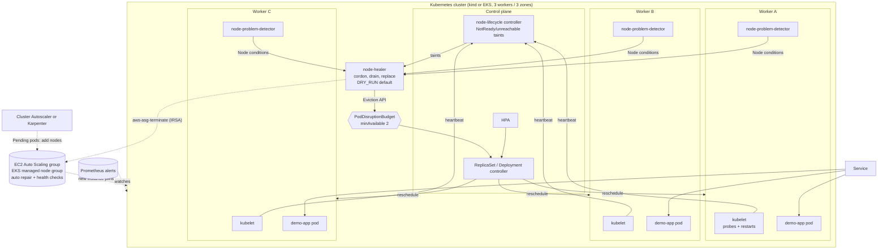

# k8s-self-healing-pods-and-nodes

Self-healing Kubernetes for **both layers**: the *pods* (probes, restart policy, PDB, HPA, topology spread) and the
*servers* (node-problem-detector, a PDB-aware `node-healer` controller, EKS managed node group auto-repair,
ASG health checks, Cluster Autoscaler). Includes chaos scripts to break things on a local **kind** cluster and
watch them recover, Prometheus alerts, Terraform for EKS in `ap-south-1`, and unit tests.

> Companion to [`k8s-self-healing`](https://github.com/shubhamkhedkar/k8s-self-healing) (pod-level only). This repo adds node/server healing.
>
> **Nothing in this repo has been deployed by the author.** Everything was validated statically (pytest, kubeconform,
> yamllint, promtool, `terraform validate`). The kind/EKS steps below are for you to run - see [Verification status](#verification-status).

## Architecture



## How self-healing works

### Pods

| Failure | Detected by | Healed by | Demo |
|---|---|---|---|
| Process crashes (exit 1) | kubelet sees container exit | container **restart** (same pod, `restartCount+1`, backoff) | `chaos/crash-app.sh` |
| Process hangs / deadlocks | **liveness** probe `/healthz` times out 3x | kubelet kills + restarts container | `chaos/hang-app.sh` |
| Slow start | **startup** probe (up to 60s) gates liveness so slow boots are not killed | - | on every rollout |
| Not able to serve | **readiness** probe `/ready` fails | pod pulled from Service endpoints; **no restart** | `chaos/unready-app.sh` |
| Pod deleted / evicted | ReplicaSet controller | new pod scheduled | `chaos/kill-pods.sh` |
| Load spike | HPA (CPU 60%, 3-10 replicas) | more replicas | `kubectl run` load generator (below) |
| Bad release | rolling update `maxUnavailable: 0`, `minReadySeconds`, `progressDeadlineSeconds` | old pods keep serving; `kubectl rollout undo` | - |
| Planned maintenance | **PodDisruptionBudget** `minAvailable: 2` | drains wait for replacements to be Ready | `MODE=cordon chaos/node-failure.sh` |
| One node/AZ lost | `topologySpreadConstraints` (hostname hard, zone soft) + anti-affinity | replicas live on different nodes, so at least 2 survive | - |

Key manifest: [`deploy/base/app-deployment.yaml`](deploy/base/app-deployment.yaml).

### Nodes / servers

See [`docs/node-healing.md`](docs/node-healing.md) for the full layer table, the node-healer flowchart, safety rails and
the AWS layer. Short version:

1. kubelet stops heart-beating -> control plane marks the node `Unknown` and taints it (~40s).
2. App pods tolerate that taint for only **30s** (default 300s) -> evicted and rescheduled on healthy nodes.
3. node-problem-detector surfaces kernel/filesystem faults as Node conditions.
4. **node-healer** (`node-healer/`) waits for the threshold, then **cordons -> drains via the Eviction API (PDBs respected)
   -> replaces** (`delete-node` or `aws-asg-terminate`). `DRY_RUN=true` by default; refuses to act when >34% of nodes are unhealthy.
5. On EKS the managed node group's ASG / auto repair and Cluster Autoscaler bring capacity back.

## Repo layout

```
app/                  Flask demo app (/healthz /ready /metrics + chaos endpoints), Dockerfile, tests
node-healer/          Python controller (kubernetes client): health.py drain.py replace.py controller.py, tests
deploy/base/          Kustomize: Deployment, Service, PDB, HPA, NPD DaemonSet+config, healer + RBAC
deploy/overlays/kind  fast thresholds, healer really acts (delete-node)
deploy/overlays/eks   ECR images, IRSA annotation, healer DRY-RUN + aws-asg-terminate
deploy/monitoring/    PrometheusRule (alerts) + PodMonitors (needs kube-prometheus-stack)
kind/kind-config.yaml 1 control plane + 3 workers in 3 fake zones
chaos/                kill-pods, crash-app, hang-app, unready-app, node-failure, restore-node
terraform/            EKS (ap-south-1), managed node group + auto repair, IRSA, optional self-managed ASG
.github/workflows/    ci.yml (lint, test, kubeconform, terraform validate) - Actions disabled on this repo
```

## Run it locally on kind

Prereqs: Docker, [kind](https://kind.sigs.k8s.io/), kubectl, (optional) Prometheus stack. **Run this only on your machine; it creates a local Docker-based cluster.**

```bash
# 0. (optional) verify everything statically first
make validate

# 1. cluster with 1 control plane + 3 workers in zone-a/b/c
make kind-up            # docker build x2, kind create, kind load, install metrics-server (for the HPA)

# 2. deploy (kustomize overlay for kind)
make deploy-kind
kubectl -n self-healing get pods -o wide        # 3 demo-app pods on 3 different workers
kubectl -n self-healing get pdb,hpa

# 3. pod-level chaos (each script prints a recovery timeline)
chaos/kill-pods.sh          # delete 2 of 3 pods
chaos/crash-app.sh          # exit(1) -> container restart
chaos/hang-app.sh           # liveness failure -> restart
chaos/unready-app.sh        # readiness failure -> out of endpoints, no restart
# or: make chaos-pods

# 4. HPA (separate terminal)
kubectl -n self-healing run load --rm -it --image=busybox -- /bin/sh -c 'while true; do wget -q -O- http://demo-app/ >/dev/null; done'
kubectl -n self-healing get hpa -w

# 5. node-level chaos
kubectl -n self-healing logs deploy/node-healer -f &        # watch decisions
MODE=cordon        chaos/node-failure.sh                    # planned drain: PDB keeps >=2 pods Ready
chaos/node-failure.sh                                       # kubelet stopped => NotReady => pods moved in ~70s,
                                                            # healer cordons+drains+deletes the node after 60s
chaos/restore-node.sh <node-name-printed-above>             # bring the kubelet back; node re-registers
# MODE=stop-node chaos/node-failure.sh                      # hard power-off of the node container
```

What you should see: `kubectl get pods -w` shows replacements scheduled on surviving workers; `ready=3/3` within
~1-2 minutes of a node failure; node-healer logs `node X unhealthy: NotReady ... -> cordon -> drain -> replace`.
Because `topologySpreadConstraints` uses `DoNotSchedule` on hostname with only 2 workers left, the third replica
may stay `Pending` until the node returns (that is intentional - shows the spread constraint; use `ScheduleAnyway` if you prefer availability over spread).

Teardown: `make kind-down` (and `docker image rm self-heal-demo:dev node-healer:dev`).

## Run it on EKS (ap-south-1) - costs money

**You** run these; nothing here was ever applied by the author. Prereqs: AWS credentials, Terraform >= 1.5, kubectl, Docker, AWS CLI.

```bash
# 1. Infrastructure (about 15-20 min). Restrict the API endpoint to your IP!
cd terraform
terraform init
terraform plan  -var 'cluster_endpoint_public_access_cidrs=["<your-ip>/32"]' -out tfplan
terraform apply tfplan
$(terraform output -raw update_kubeconfig)

# 2. Images -> ECR
ACCOUNT=$(aws sts get-caller-identity --query Account --output text); REG=$ACCOUNT.dkr.ecr.ap-south-1.amazonaws.com
aws ecr create-repository --region ap-south-1 --repository-name self-heal-demo
aws ecr create-repository --region ap-south-1 --repository-name node-healer
aws ecr get-login-password --region ap-south-1 | docker login --username AWS --password-stdin $REG
docker build -t $REG/self-heal-demo:latest ../app && docker push $REG/self-heal-demo:latest
docker build -t $REG/node-healer:latest ../node-healer && docker push $REG/node-healer:latest

# 3. Deploy. Substitute ACCOUNT_ID placeholders in the EKS overlay (and the IRSA role ARN from terraform output).
cd ..
kustomize build deploy/overlays/eks | sed "s/ACCOUNT_ID/$ACCOUNT/g" | kubectl apply -f -
kubectl -n self-healing get pods -o wide        # spread across 3 AZs
kubectl -n self-healing logs deploy/node-healer -f   # starts in DRY_RUN=true

# 4. Real node failure drill: terminate an EC2 worker in the console / CLI (it is just a server)
aws ec2 terminate-instances --region ap-south-1 --instance-ids <i-...>
#   -> ASG launches a replacement, pods are rescheduled, Cluster Autoscaler/ASG restore capacity.
#    To test node-healer itself: stop the kubelet via SSM (aws ssm start-session ... ; sudo systemctl stop kubelet),
#    read its DRY-RUN decision in the logs, then set DRY_RUN=false and repeat.

# 5. Optional monitoring (needs kube-prometheus-stack)
kubectl apply -k deploy/monitoring
```

Optional: install Cluster Autoscaler (Helm chart `autoscaler/cluster-autoscaler`, `autoDiscovery.clusterName=self-healing-demo`,
service account annotated with `terraform output cluster_autoscaler_role_arn`) or Karpenter.

### Teardown (do not forget - the cluster bills hourly)

```bash
kubectl delete -k deploy/overlays/eks      # (use the sed pipeline with `kubectl delete -f -` if you substituted)
cd terraform && terraform destroy
aws ecr delete-repository --region ap-south-1 --repository-name self-heal-demo --force
aws ecr delete-repository --region ap-south-1 --repository-name node-healer  --force
```
Check for leftover load balancers/ENIs/volumes in the console if `destroy` hangs.

### Cost notes (approximate, ap-south-1, on-demand; check the AWS pricing calculator)

| Item | ~Price | Notes |
|---|---|---|
| EKS control plane | ~$0.10/h (~$73/mo) | flat per cluster |
| 3 x t3.medium workers | ~$0.045/h each | ~$100/mo if left on |
| 1 NAT gateway | ~$0.056/h + data | `single_nat_gateway=true` (demo); one per AZ for prod |
| EBS (3 x 30 GB gp3) + CloudWatch logs | a few $/mo | |

Roughly **$0.30-0.35/hour (~$8/day)** while running. A 2-hour drill is a couple of dollars. kind is free.

## Configuration: node-healer

| Env var | Default | Meaning |
|---|---|---|
| `DRY_RUN` | `true` | log only; set `false` to act |
| `REPLACE_MODE` | `none` | `none` / `delete-node` / `aws-asg-terminate` |
| `NOT_READY_THRESHOLD_SECONDS` | `300` | how long a node must be unhealthy |
| `POLL_INTERVAL_SECONDS` | `30` | reconcile period |
| `DRAIN_TIMEOUT_SECONDS` | `300` | retry window for PDB-blocked evictions |
| `MAX_UNHEALTHY_FRACTION` | `0.34` | refuse to act above this fraction of nodes |
| `COOLDOWN_SECONDS` | `600` | min gap between remediations |
| `BAD_CONDITIONS` | `KernelDeadlock,ReadonlyFilesystem,FrequentKubeletRestart` | NPD conditions that count as unhealthy |

Metrics on `:9102/metrics`: `node_healer_unhealthy_nodes`, `node_healer_actions_total{action,result}`.
Alerts (`deploy/monitoring/prometheusrule.yaml`): `PodCrashLooping`, `PodNotReady`, `DeploymentReplicasMismatch`,
`PDBNoDisruptionsAllowed`, `HPAMaxedOut`, `NodeNotReady`, `NodeProblemDetected`, `NodeMemory/DiskPressure`,
`NodeUnschedulableTooLong`, `NodeHealerRefusing`, `NodeHealerDrainTimeout`.

Run the controller against a cluster from your laptop (dry-run, reads your kubeconfig):
`cd node-healer && pip install -r requirements.txt && DRY_RUN=true python -m node_healer.main`.

## Development & verification

```bash
pip install pytest ruff yamllint -r app/requirements.txt -r node-healer/requirements.txt
make validate     # ruff, yamllint, pytest, kubeconform, promtool, terraform validate
```

`make validate` needs `kustomize`, `kubeconform`, `promtool`, `terraform` on PATH (each target is also runnable individually).

### Verification status

Verified locally by the author (no cluster, no cloud): pytest (35 tests: demo app + node-healer with a mocked
Kubernetes client), ruff, yamllint, kubeconform on the rendered base/kind/eks/monitoring kustomizations (Kubernetes 1.30 schemas + CRD schemas),
promtool on the alert rules, `terraform fmt` + `terraform validate`.

**Not verified** (needs a real cluster/AWS - treat as a starting point): Docker image builds, the kind demo end-to-end,
chaos script timings, NPD journal parsing on your OS image, EKS apply, IRSA, node auto-repair behaviour/timings,
the optional self-managed ASG node bootstrap, Prometheus rule behaviour against live metrics.

## CI

`.github/workflows/ci.yml` (lint, test, kubeconform, terraform validate) is committed, but **GitHub Actions is disabled** on this repo;
enable it under Settings -> Actions if you want it to run. Checks are identical to `make validate`.

## License

MIT
