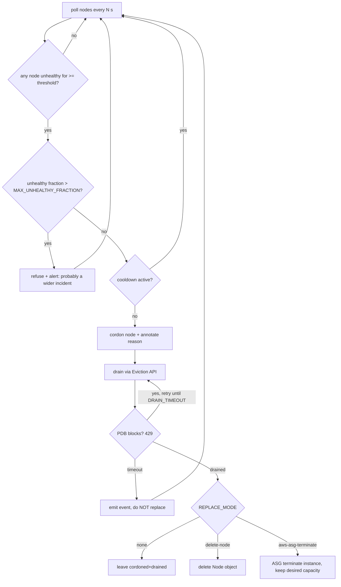

# Node / server self-healing: the layers

Pods heal themselves through the kubelet and controllers. **Servers (nodes) need more layers**, because
once the machine is gone nothing on it can restart anything. This project stacks four of them, from
fastest/most local to slowest/most drastic:

| # | Layer | Detects | Reacts | Typical latency |
|---|-------|---------|--------|-----------------|
| 1 | **Control plane node-lifecycle controller** | kubelet stopped heart-beating (`node-monitor-grace-period`, 40s) | marks node `Ready=Unknown`, adds `not-ready` / `unreachable` NoExecute taints | ~40s |
| 2 | **Taint-based eviction** (Deployment tolerations) | those taints | evicts pods after `tolerationSeconds` (we set **30s**, default is 300s); ReplicaSet reschedules them on healthy nodes | +30s |
| 3 | **node-problem-detector** (DaemonSet) | kernel deadlock, read-only filesystem, OOM storms... | sets Node *conditions* (`KernelDeadlock`, `ReadonlyFilesystem`) and Events, exports `problem_gauge` | seconds |
| 4 | **node-healer** (this repo) | Node `NotReady` longer than a threshold, or a bad NPD condition | **cordon -> drain (Eviction API, PDB-respecting) -> optional replace** | threshold (300s default) |
| 5 | **Cloud layer**: ASG health checks, EKS managed node group *auto repair*, Cluster Autoscaler / Karpenter | EC2 status-check failures, node NotReady, pending pods | terminate + launch a replacement instance, add capacity | minutes |

Layers 1-2 keep the *application* available (pod-level healing, covered in the README). Layers 3-5 get the
*capacity* back.

## node-healer decision flow

Safety rails (all covered by unit tests):

* `DRY_RUN=true` by default - only logs what it *would* do.
* Never touches control-plane nodes or nodes labelled `node-healer.io/ignore`.
* Only one node per pass, with a cooldown between remediations.
* Refuses to act if more than `MAX_UNHEALTHY_FRACTION` (34%) of nodes are unhealthy - a network partition or
  control-plane problem would otherwise make it drain the whole cluster.
* Uses the **Eviction API**, so PodDisruptionBudgets are honoured. A drain that a PDB blocks past the
  timeout leaves the node cordoned and *does not* replace it.
* Dead-kubelet nodes: pods on a node whose kubelet is gone can never finish terminating; the drain is
  considered complete once every pod has a `deletionTimestamp`, and the node object deletion / instance
  termination lets the control plane garbage-collect them.
* RBAC: `delete nodes` lives in a separate ClusterRole (`node-healer-replace`) that only the overlays bind.

## EKS / AWS layer

**Managed node groups** are Auto Scaling groups that EKS creates and manages (`terraform/node_group.tf`):

* The ASG replaces instances that fail **EC2 system/instance status checks**.
* **Node auto repair** (`node_repair_config { enabled = true }`): EKS watches node health (kubelet `Ready` and
  node-monitoring signals such as those from the EKS node monitoring agent / node-problem-detector conditions)
  and automatically replaces or reboots unhealthy nodes. For a plain `NotReady` node the wait is on the order
  of 30 minutes by design, and EKS pauses repairs when too many nodes in the group are unhealthy
  (check the current AWS docs for the exact numbers). **node-healer acts much sooner** (minutes) and drains
  gracefully first, so the two are complementary: healer = fast + PDB-aware, auto repair = backstop.
* `update_config.max_unavailable = 1` bounds disruption during AMI/version upgrades (which also respect PDBs).
* 3 private subnets in 3 AZs: the ASG re-balances and re-launches instances across `ap-south-1a/b/c`.

**Self-managed ASG** (optional, `-var enable_self_managed_asg=true`, `terraform/self_managed_asg.tf`) exposes
the raw knobs: `health_check_type` (`EC2` or `ELB`), `health_check_grace_period`, `instance_refresh`
(rolling replacement), `capacity_rebalance` (Spot).

**Capacity**: tags `k8s.io/cluster-autoscaler/enabled` and `.../<cluster>=owned` enable Cluster Autoscaler
auto-discovery; an IRSA role for it is created. Cluster Autoscaler adds nodes when pods are `Pending`
(e.g. after a node loss) and removes under-used nodes. **Karpenter** is the modern alternative: it provisions
right-sized instances directly (no ASG) and has native disruption/consolidation + node expiry; if you adopt
it, keep node-healer in `delete-node` mode - Karpenter will launch the replacement.

**IRSA**: `aws_iam_role.node_healer` allows only `autoscaling:TerminateInstanceInAutoScalingGroup` (scoped by the
`eks:cluster-name` tag) plus two describe calls, assumable only by `system:serviceaccount:self-healing:node-healer`.

## node-problem-detector

`deploy/base/npd-daemonset.yaml` runs NPD v0.8.19 with a trimmed kernel monitor reading the host journal.
Permanent problems set a Node condition; temporary ones emit Events. node-healer treats the conditions listed in
`BAD_CONDITIONS` (default `KernelDeadlock,ReadonlyFilesystem,FrequentKubeletRestart`) as unhealthy once they
have been `True` for the threshold. Log source paths differ per OS (journald on AL2023, `/var/log/kern.log` on
Ubuntu) - adjust `kernel-monitor.json` for your AMI. On kind the journal may be absent; NPD will then just log
errors and the NotReady path still works.
